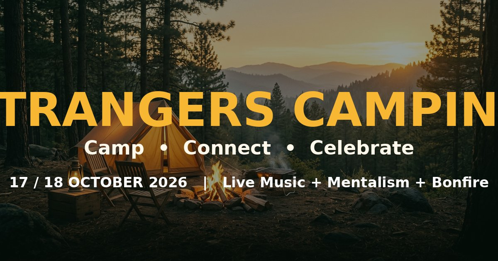

# Strangers Camping — Landing Page

Official landing page for **Strangers Camping — Camp • Connect • Celebrate** (17 / 18 October).
A single-page, dependency-free static site. No build step, no framework, no CDN — just open it and it works.



---

## ✨ What's inside

| Section | What it does |
|---|---|
| Hero | Golden-hour campsite backdrop, logo, live countdown to 17 Oct, feature strip |
| Marquee | Scrolling "Camp • Connect • Celebrate" band |
| About | The idea behind the camp + featured poster with floating badges |
| Experience | 8 cards — camping, bonfire, music, mentalism, trekking, BBQ, star gazing, games |
| Hosts | Aneesh (Mentalist & Hypnotism) and Arislan Amood (Singer) |
| Schedule | Day 1 / Day 2 tabs with an hour-by-hour timeline |
| Passes | Day Camper · Full Camp · Camp Crew, each with its own WhatsApp message |
| Booking | Form that fills everything into a ready-to-send WhatsApp message |
| Gallery | 4 posters + 2 photos with a full-screen viewer (save / share) |
| FAQ | 8 expandable questions |
| Footer | Camp details, contacts, credit |

**Tech:** plain HTML + CSS + vanilla JavaScript. All fonts are self-hosted, all icons are inline SVG, every image lives in `assets/img` — the site works fully offline and needs no internet to render correctly.

---

## 📁 Structure

```
strangers-camping/
├── index.html            ← all page content lives here
├── 404.html              ← friendly not-found page (for GitHub Pages / Netlify)
├── favicon.png
├── README.md
└── assets/
    ├── css/main.css      ← styling (colours, layout, animations)
    ├── js/main.js        ← countdown, nav, form, WhatsApp launcher  ← EDIT NUMBERS HERE
    ├── fonts.css         ← self-hosted font faces
    ├── fonts/            ← Anton, Inter, Playfair Display, Satisfy (woff2)
    └── img/              ← posters, photos, logo, hero backdrop
```

---

## 🔧 Make it yours

### 1. Change the WhatsApp numbers or event date — one place only

Open **`assets/js/main.js`**, top of the file:

```js
const CONFIG = {
  waNumber:  '916238147823',                       // main booking number, digits only
  waNumber2: '919544454298',                       // second number
  eventStart: '2026-10-17T16:00:00+03:00',         // countdown target (ISO, with timezone)
  eventLabel: '17 / 18 October 2026',              // shown in the top bar + booking message
  defaultMessage: "Hi! I'd like to know more about Strangers Camping (17/18 October)."
};
```

Every WhatsApp button, the floating button and the booking form read from this block.
Note: also update the visible phone numbers inside `index.html` if they change (search for `6238`).

### 2. Change prices / wording

All text is in `index.html` — search for the heading you want to edit.
Passes are deliberately set to **"On request"**; replace with real prices when you have them.

### 3. Colours

`assets/css/main.css`, first block:

```css
:root{
  --ink:#0E2A1C;      /* deep forest green  */
  --amber:#F7B733;    /* brand gold         */
  --ember:#E2571E;    /* fire orange        */
  --cream:#FFF8EC;    /* background         */
}
```

### 4. WhatsApp behaviour

| Device | What happens on click |
|---|---|
| Phone / tablet | Hands straight off to the WhatsApp app, same tab, message pre-filled → just press send |
| Desktop | Opens WhatsApp Desktop app, or WhatsApp Web in a new tab |
| Pop-up blocked | A fallback card appears with the number, the ready-made message and copy buttons |

---

## 🚀 Publish it

### Option A — GitHub (no command line)

1. On github.com click **New repository** → name it e.g. `strangers-camping` → **Public** → **Create**.
2. On the empty repo page click **uploading an existing file**.
3. Drag **the contents** of the `strangers-camping` folder (not the folder itself) into the browser window → **Commit changes**.
4. Go to **Settings → Pages** → *Source*: `Deploy from a branch` → *Branch*: `main` / `root` → **Save**.
5. Wait ~1 minute → your site is live at `https://<your-username>.github.io/strangers-camping/`

### Option B — GitHub with Git installed

```bash
cd strangers-camping
git init
git add .
git commit -m "Strangers Camping landing page"
git branch -M main
git remote add origin https://github.com/<your-username>/strangers-camping.git
git push -u origin main
```

Then enable Pages as in step 4 above.

### Option C — Netlify / Vercel (custom domain friendly, fastest)

* **Netlify:** app.netlify.com/drop → drag the `strangers-camping` folder → instant live URL. Add your domain under *Domain settings*.
* **Vercel:** vercel.com/new → *Import* the GitHub repo (or drag the folder) → Deploy. No build command, output directory `.` or root.

> Since there is no build step, any web host works: cPanel, Hostinger, S3, Cloudflare Pages — just upload the folder to `public_html`.

---

## ✅ Before you go live — checklist

- [ ] WhatsApp numbers correct in `assets/js/main.js` **and** in the visible text of `index.html`
- [ ] Real pass prices added (or keep "on request")
- [ ] Schedule timings confirmed
- [ ] Campsite details / meeting point decided (currently "shared on booking")
- [ ] Send a test booking from your own phone to check the message the customer sends you
- [ ] Replace `assets/img/og-image.jpg` if you want a different link-preview image

---

## 📝 Notes

- The gallery poster images are downscaled versions of the originals for fast loading; the full-resolution artwork is in the source folder outside this repo.
- `og-image.jpg` (1200×630) is what shows up when the link is shared on WhatsApp, Facebook or X.
- Accessibility: keyboard focus states, `aria` labels on the menu/tabs/lightbox, and `prefers-reduced-motion` support are built in.
- Everything is static and safe to cache hard: no API keys, no tracking, no third-party requests.

**Camp • Connect • Celebrate** — see you around the fire. 🔥
